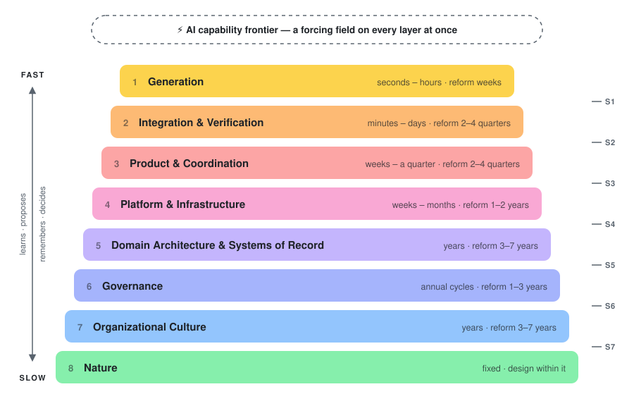
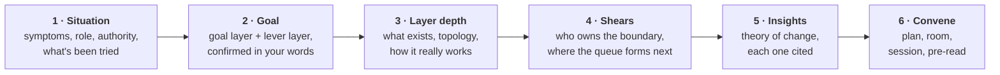

<div align="center">

# Pace Layers

**Plan change at the speed each part of your organization can actually move.**

[](.claude-plugin/plugin.json)
[](#install)
[](#the-skills)
[](LICENSE)

[Why](#why-pace-layers) · [The model](#the-model) · [How it works](#how-it-works) · [Skills](#the-skills) · [Install](#install) · [Use](#use)

<br>



</div>

<br>

Pace Layers is a set of agent skills for engineers, product leaders, and executives who want to change how their software organization works: rolling out coding agents, fixing a review queue, modernizing a core system, changing an approval process, shifting a culture.

It interviews you about your situation, pins your goal to the right layer, digs into how that layer really works, checks the boundaries where change usually dies, and leaves you with:

<table>
<tr>
<td width="25%" valign="top">

**📄 A plan**

Moves sequenced by pace, the decisions that need owners, risks, and indicators.

</td>
<td width="25%" valign="top">

**🧭 The room**

The handful of people who need to review the plan together, why each one, and what each brings.

</td>
<td width="25%" valign="top">

**🕰️ A 90-minute session**

For that room to imagine the future the plan describes, find how it fails, and decide.

</td>
<td width="25%" valign="top">

**✉️ A pre-read**

A short invitation with one question per person, sent before the session.

</td>
</tr>
</table>

---

## Why pace layers

Stewart Brand observed that durable systems are stacks of layers changing at different speeds. **Fast layers learn and propose; slow layers remember and decide what lasts.** Fast gets the attention, slow has the power.

Most change efforts fail in one of three ways:

1. They push where the **symptom** shows instead of where the **lever** is. Symptoms surface in fast layers; levers usually sit one to three layers slower.
2. They move a layer **faster than it can move**, or hold it slower than it needs to.
3. They ignore the **shear**: the boundary between two layers, where tension builds and nobody is in charge.

> [!IMPORTANT]
> AI makes all three worse. It accelerates the fastest, least powerful layer (writing code) and pushes the load onto slower ones: review, architecture, governance, and people's attention.

## The model

| # | Layer | Natural clock | Reform horizon | Changes by |
|:-:|---|---|---|---|
| 1 | 🟨 **Generation** | seconds to hours | weeks | explore and discard |
| 2 | 🟧 **Integration and Verification** | minutes to days | 2–4 quarters | re-capacitate |
| 3 | 🟥 **Product and Coordination** | weeks to a quarter | 2–4 quarters | decide and prune |
| 4 | 🩷 **Platform and Infrastructure** | weeks to months | 1–2 years | pave |
| 5 | 🟪 **Domain Architecture and Systems of Record** | years | 3–7 years | seam and slow |
| 6 | 🔷 **Governance** | annual cycles; principles over decades | 1–3 years | codify controls, preserve judgment |
| 7 | 🟦 **Organizational Culture** | years | 3–7 years | embed |
| 8 | 🟩 **Nature** (cognition, skills, compute, seasonality) | fixed | none | design within |

Every layer has **two clocks**: how often its contents change, and how long it takes to change *how it works*. Confusing the two is the most common planning error the skills catch.

The **AI capability frontier** sits outside the stack as a forcing field that acts on every layer at once.

<details>
<summary><b>The seven shears</b> — where tension builds between adjacent layers</summary>

<br>

| Shear | Between | Tension | What it looks like |
|:-:|---|---|---|
| S1 | Generation and Verification | Volume versus comprehension ("the review wall") | Review queues, oversized changes, merges with no real review, rising change-failure rate |
| S2 | Verification and Product | Shipped versus valuable | Throughput up, outcomes flat; building the wrong thing faster |
| S3 | Product and Platform | Bespoke versus paved road | Shadow tooling, every team running its own agent stack, unclear AI stance |
| S4 | Platform and Domain | Edge speed versus core integrity | Generated customizations in the core system; growing upgrade debt |
| S5 | Domain and Governance | Decision logic under policy or regulation | Untraceable rule changes, audit findings, failed outcome testing |
| S6 | Governance and Culture | Compliance versus ownership | Checkbox controls, blame after incidents, blanket tool bans |
| S7 | Culture and Nature | Ambition versus human limits | Burnout, skill atrophy, comprehension debt, collapsing junior pipeline |

</details>

> [!NOTE]
> The horizons are heuristics. The skills ask for your own data and tell you when they are uncalibrated. The full model lives in [`skills/pace-layers/references/model.md`](skills/pace-layers/references/model.md).

## How it works



Every step is resumable: the working brief is written to disk as the session goes.

## The skills

| | Skill | What it does |
|:-:|---|---|
| 🧭 | [`pace-layers`](skills/pace-layers/SKILL.md) | **The entry point.** Runs the whole flow: situation, goal, layer depth, shears, insights, plan. |
| 🎯 | [`goal-at-layer`](skills/goal-at-layer/SKILL.md) | Turns an ambition into a goal pinned to a layer, with the lever layer, an honest horizon, evidence for done, guardrails, and an owner. |
| 1 | [`layer-generation`](skills/layer-generation/SKILL.md) | People and agents writing code; the inner loop. |
| 2 | [`layer-verification`](skills/layer-verification/SKILL.md) | Review, CI, release, incident response. Often the binding constraint. Includes a review-flow script. |
| 3 | [`layer-product`](skills/layer-product/SKILL.md) | Intent, specs, priorities, cross-team sequencing. |
| 4 | [`layer-platform`](skills/layer-platform/SKILL.md) | CI/CD, runtime, golden paths, model gateway, evaluation suites. |
| 5 | [`layer-domain`](skills/layer-domain/SKILL.md) | Domain model, core systems, integration contracts, team boundaries. Includes a knowledge-concentration script. |
| 6 | [`layer-governance`](skills/layer-governance/SKILL.md) | Security, compliance, risk, approvals, funding, AI policy. |
| 7 | [`layer-culture`](skills/layer-culture/SKILL.md) | Ownership, trust, incident norms, what gets rewarded. |
| 8 | [`layer-nature`](skills/layer-nature/SKILL.md) | Attention, cognitive load, skill formation, compute cost, seasonality. |
| ⚡ | [`shear-check`](skills/shear-check/SKILL.md) | The boundaries between layers: who owns them, what crosses them, where the next bottleneck forms. |
| 🤝 | [`convene`](skills/convene/SKILL.md) | Writes the plan, picks the room, designs the session, drafts the pre-read. |

Each layer skill asks about three things: **what exists** at that layer, its **topology** (who and what connects to what, and who decides), and **how it really works** under the hood. Then it looks at the forces acting on the layer from faster layers, slower layers, and the AI frontier.

## Install

### Claude Code (plugin)

```text
/plugin marketplace add Flying-Pig-Labs/pace-layers
/plugin install pace-layers@pace-layers
```

<details>
<summary><b>Claude Code (skills only)</b></summary>

<br>

Copy the folders in `skills/` into `~/.claude/skills/` for yourself, or `.claude/skills/` in a project for your team.

```bash
git clone https://github.com/Flying-Pig-Labs/pace-layers.git
cp -R pace-layers/skills/* ~/.claude/skills/
```

</details>

<details>
<summary><b>Other agents</b></summary>

<br>

Each folder in `skills/` is a standard Agent Skill (`SKILL.md` with `name` and `description` frontmatter). Any client that supports Agent Skills can load them. The skills reference each other by name and fall back to reading sibling folders when they can't invoke one another.

</details>

## Use

Start the full flow:

```text
/pace-layers:pace-layers
```

Or just describe the problem. The skills trigger on situations like these:

> 💬 *Our coding-agent rollout has stalled. Engineers love it but reviews now take a week and change failures are up. Help me plan what to do.*

> 💬 *I want to move our business rules out of the core platform over the next year. Who do I need on board and where do I start?*

> 💬 *Leadership wants us to "be AI-first" by Q2. What does that actually mean for my org, and what's realistic?*

Go straight to one piece:

```text
/pace-layers:goal-at-layer      # sharpen a goal
/pace-layers:layer-governance   # interview one layer
/pace-layers:shear-check        # diagnose a boundary
/pace-layers:convene            # you have a goal; build the plan and the room
```

### What you get

```text
pace-layers/<goal-slug>/
├── brief.md    # the working brief, built up across the session (resumable)
├── plan.md     # the plan document for the room
└── invite.md   # the pre-read, with one question per person
```

### Measuring before asking

In Claude Code with repository access, two layer skills can measure instead of asking:

```bash
# Review flow: time to first review, time to merge, size, unreviewed share, reviewer concentration
gh pr list --state merged --limit 500 \
  --json number,createdAt,mergedAt,additions,deletions,changedFiles,author,reviews > prs.json
python3 skills/layer-verification/scripts/pr_flow.py prs.json

# Knowledge concentration: who holds the theory of each area, and where the key-person risk is
python3 skills/layer-domain/scripts/theory_holders.py --repo . --months 18
```

> [!TIP]
> Both scripts are read-only and use only the Python standard library.

## How the skills behave

| | |
|---|---|
| **Information first, then the goal.** | They won't write a plan before you have confirmed a goal in your own words. |
| **Two to four questions at a time.** | With a summary and "what did I get wrong?" at each step. |
| **"I don't know" is data.** | Unknowns become discovery tasks and, often, seats in the room. |
| **Every insight cites what you said.** | Generic advice is labeled as generic. |
| **They push back.** | When a goal can't fit its timeline, or the lever sits in a layer you are avoiding. |
| **They don't decide for you or contact anyone.** | The roster records roles, authority, and stated concerns, never judgments about people. |

## Ideas this stands on

- Stewart Brand, *The Clock of the Long Now* (1999) and "Pace Layering: How Complex Systems Learn and Keep Learning," *Journal of Design and Science* (2018); *How Buildings Learn* (1994).
- Frank Duffy's shearing layers of buildings.
- Lance Gunderson and C. S. Holling, *Panarchy* (2002): adaptive cycles, revolt and remember, rigidity traps.
- Edgar Schein, *Organizational Culture and Leadership*: primary and secondary embedding mechanisms.
- Eliyahu Goldratt's Theory of Constraints; Little's law; Amdahl's law.
- Conway's law, and Matthew Skelton and Manuel Pais, *Team Topologies*.
- Peter Naur, "Programming as Theory Building" (1985).
- Gartner's pace-layered application strategy (systems of record, differentiation, innovation).
- Kief Morris on humans in, on, and outside the loop (martinfowler.com, 2026).
- Matt Beane and Paul Leonardi on organizations as pace layers under intelligent technologies (*Journal of Management Studies*, 2025).
- DORA's 2024 and 2025 research on AI-assisted software development, and METR's studies of developer productivity.

## Contributing

Issues and pull requests are welcome, especially:

- **Calibration data**: how long layer changes actually took in your organization.
- **New diagnostic patterns** for the "Reading the answers" tables.
- **Layer adaptations** for non-software organizations.

## License

MIT © 2026 Flying Pig Labs. See [LICENSE](LICENSE).

<div align="center">
<br>
<sub><i>Fast learns. Slow remembers.</i></sub>
</div>
